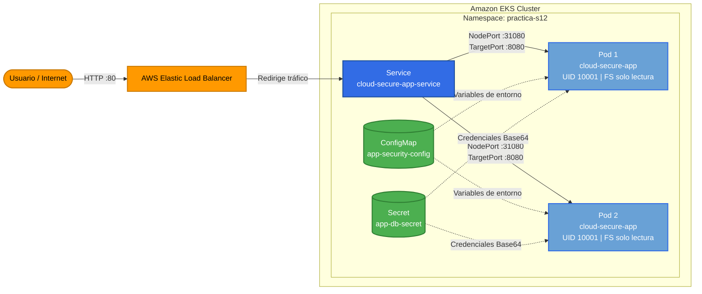

# 🚀 Despliegue Cloud, Seguridad y Troubleshooting en Kubernetes (AWS)

[](https://kubernetes.io/)
[](https://aws.amazon.com/eks/)
[](https://kubernetes.io/docs/concepts/security/)
[](LICENSE)

Proyecto práctico correspondiente a la práctica **S12 | AP9: Despliegue Cloud, Seguridad y Troubleshooting**. Implementa una arquitectura distribuida y resiliente sobre **Amazon Web Services (AWS)** con hardening de seguridad avanzado, sondas de salud y resolución integral de tres escenarios críticos de fallo.

---

## 📌 Objetivos y Alcance del Proyecto

1. **Aislamiento del Entorno:** Creación y configuración del espacio de nombres `practica-s12` en AWS.
2. **Hardening de Seguridad (SecurityContext):**
   * Prevenir ejecución como usuario `root` (`runAsNonRoot: true`).
   * Asignación estricta de UID sin privilegios (`runAsUser: 10001`).
   * Bloqueo del sistema de archivos a solo lectura (`readOnlyRootFilesystem: true`).
   * Revocación total de capacidades del Kernel (`drop: ["ALL"]`) y bloqueo de escalamiento de privilegios.
   * Gestión de credenciales mediante `Secrets` codificados en Base64.
3. **Troubleshooting Sistemático (3 Escenarios de Fallo Resueltos):**
   * **Escenario A (Configuración):** Diagnóstico y remediación de Pods en `CrashLoopBackOff` por claves inexistentes en ConfigMaps y Secrets.
   * **Escenario B (Red y Conectividad):** Resolución de desalineación en selectores de servicio y configuración de CoreDNS FQDN para base de datos interna en puerto `5432`.
   * **Escenario C (Sondas de Salud):** Corrección de endpoints erróneos y calibración de tolerancia en `livenessProbe` y `readinessProbe`.
4. **Exposición Segura en AWS:** Configuración de `LoadBalancer` en AWS Elastic Load Balancing (ELB) con mapeo hacia `NodePort` y grupos de seguridad VPC.

---

## 📁 Estructura Oficial del Repositorio

```plaintext
/
├── k8s/
│   ├── 00-namespace.yaml                 # Espacio de nombres practica-s12
│   ├── 01-security-configmap.yaml        # ConfigMap de variables no sensibles y FQDN
│   ├── 02-db-secret.yaml                 # Secretos de base de datos en Base64
│   ├── 03-app-deployment.yaml            # Deployment principal con SecurityContext y Sondas
│   └── 04-app-service.yaml               # Servicio LoadBalancer para AWS ELB
├── docs/
│   └── troubleshooting-log.md            # Bitácora de errores encontrados y soluciones
├── scripts/
│   ├── deploy.sh / deploy.ps1            # Automatización del despliegue oficial
│   └── diagnose.sh / diagnose.ps1        # Script de auditoría y diagnóstico automático
└── README.md                             # Documentación principal del proyecto
```

---

## 🏛️ Diagrama de Arquitectura



---

## ⚙️ Guía de Despliegue Rápido

### Prerrequisitos
* Clúster de Kubernetes en ejecución (AWS EKS, Minikube o Docker Desktop Kubernetes).
* Herramienta de línea de comandos `kubectl` configurada.
* `curl` o navegador web para validaciones HTTP.

### Paso 1: Clonar el Repositorio
```bash
git clone https://github.com/<tu-usuario>/despliegue-cloud-seguridad-troubleshooting.git
cd despliegue-cloud-seguridad-troubleshooting
```

### Paso 2: Ejecutar el Despliegue
Puedes ejecutar los manifiestos uno a uno o usar el script automatizado:

**Opción A: Vía Script Automatizado**
```bash
# En Linux / macOS / WSL:
chmod +x scripts/*.sh
./scripts/deploy.sh

# En Windows (PowerShell):
.\scripts\deploy.ps1
```

**Opción B: Despliegue Manual con `kubectl`**
```bash
kubectl apply -f k8s/00-namespace.yaml
kubectl apply -f k8s/01-security-configmap.yaml
kubectl apply -f k8s/02-db-secret.yaml
kubectl apply -f k8s/03-app-deployment.yaml
kubectl apply -f k8s/04-app-service.yaml
```

---

## 🔍 Diagnóstico y Validación Automatizada

Para ejecutar la suite de diagnóstico de salud y verificar el cumplimiento de seguridad:

```bash
# Linux / macOS / WSL:
./scripts/diagnose.sh

# Windows (PowerShell):
.\scripts\diagnose.ps1
```

El script verifica automáticamente:
1. Existencia del namespace `practica-s12`.
2. Estado de Pods (`Running`, ausencia de `CrashLoopBackOff`).
3. Auditoría de UID (`10001`) y validación de usuario no privilegiado (`whoami` / `id`).
4. Verificación de sondas `livenessProbe` y `readinessProbe`.
5. Exposición del servicio y asignación de endpoints.

---

## 🔒 Especificaciones de Hardening de Seguridad (Paso 2)

El manifiesto `k8s/03-app-deployment.yaml` implementa las siguientes directivas de seguridad auditadas:

```yaml
spec:
  securityContext:
    runAsNonRoot: true
    runAsUser: 10001
    runAsGroup: 10001
    fsGroup: 10001
    seccompProfile:
      type: RuntimeDefault
  containers:
    - name: app-container
      securityContext:
        allowPrivilegeEscalation: false
        readOnlyRootFilesystem: true
        runAsNonRoot: true
        runAsUser: 10001
        capabilities:
          drop:
            - ALL
      volumeMounts:
        - name: tmp-dir
          mountPath: /tmp
```

* **Comprobación de No-Root:**
  ```bash
  kubectl exec -it <pod-name> -n practica-s12 -- whoami
  # Retorna: 10001 (Usuario no privilegiado)
  ```
* **Comprobación de Sistema de Archivos Protegido:**
  ```bash
  kubectl exec -it <pod-name> -n practica-s12 -- touch /bin/exploit
  # Retorna: touch: /bin/exploit: Read-only file system
  ```

---

## 🛠️ Resumen de Troubleshooting (Paso 3)

| Escenario | Error Inicial | Causa Raíz | Solución Aplicada |
|---|---|---|---|
| **A. Configuración** | `CrashLoopBackOff` / `CreateContainerConfigError` | Claves `CLUSTER_HOST_INEXISTENTE` e `INVALID_SECRET_KEY` no existían en ConfigMap ni Secret. | Mapeo exacto de claves y codificación Base64 en `01-security-configmap.yaml` y `02-db-secret.yaml`. |
| **B. Red / Conectividad** | `504 Timeout` / Endpoints `<none>` / No conecta a BD | Selector erróneo en Service y falta de DNS interno para base de datos en puerto `5432`. | Selector corregido a `app: cloud-secure-app` y FQDN inyectado: `db-service.practica-s12.svc.cluster.local:5432`. |
| **C. Sondas de Salud** | Reinicios continuos (`RESTARTS: 5+`) / `Unhealthy` | `livenessProbe` apuntaba a ruta inexistente con `initialDelaySeconds: 0`. | Corrección a endpoint `/healthz`, `initialDelaySeconds: 10s`, `periodSeconds: 10s`. |

Consulte la bitácora técnica completa en [`docs/troubleshooting-log.md`](docs/troubleshooting-log.md).

---

## 📤 Entregables del Proyecto

* **Repositorio de GitHub:** `https://github.com/<tu-usuario>/despliegue-cloud-seguridad-troubleshooting`
* **Informe Técnico en Google Docs:** [Enlace a Google Docs con las 4 evidencias explicadas]
* **Video Demostrativo (3 a 5 min):** [Enlace a Video en YouTube / Google Drive]

---

## 📄 Licencia
Proyecto distribuido bajo la Licencia MIT. Desarrollado con fines académicos para el laboratorio S12 | AP9.
